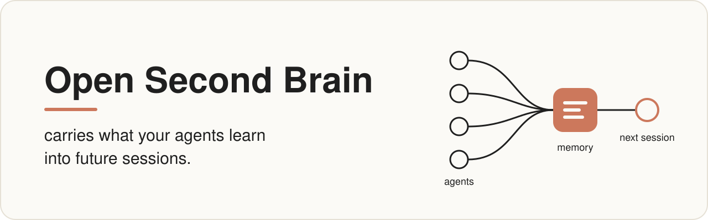
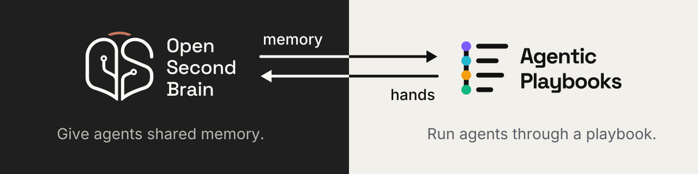

# Open Second Brain



Open Second Brain is a program that runs on your machine and connects to the AI coding agents you use: Claude Code, Codex, Grok and [others](install.md#supported-clients).
It keeps the corrections, decisions and notes your agents save, turns corrections that repeat into rules, and lets later sessions, in the same agent or a different one, use those rules.

## Why

You correct an agent, and the next session makes the same mistake. You switch agents, and the new one knows nothing the old one learned.
With Open Second Brain connected, an agent can save a correction through its tools, and every connected agent can read the rules that come out of saved corrections. Every record names the agent that wrote it.
Once a day a background pass, called dream, makes a rule of a correction that keeps coming back. A rule stays while agents record that they applied it; it is retired when that record goes stale, when agents report it outdated, or when you reject it.

## What it looks like

An example. You tell your agents a few times not to use internal abbreviations, and they save it each time:

```text
Correction, saved three times:  Expand internal abbreviations in user-facing copy.
After dream and recorded use:   Confirmed rule: Expand internal abbreviations in user-facing copy.
```

On hosts with a session-start hook, such as Claude Code and Codex, each new session receives the confirmed rules; on other hosts the agent asks for them through a tool.
If you name a folder for it (`view_target`), the rules are also written there as plain Markdown pages: `about-me.md` with the confirmed rules, a page per week of history, decisions and topics.
Rewrite a rule on `about-me.md` and your wording becomes the rule; delete its line and the rule is retired. Your edit is stored the next time the pages are rendered, and it wins over anything an agent or a model recorded.

## Install

### The easy way: let your agent do it

Paste this into the agent you want to connect:

```text
Set up Open Second Brain for this agent. Follow the "Agent setup" procedure in
https://raw.githubusercontent.com/itechmeat/open-second-brain/main/llms.txt
If Bun or the open-second-brain package is missing, tell me the command and
install it after I agree. Ask me only the questions the procedure lists. Run
o2b setup without --apply, show me the plan, then stop and wait for my explicit
approval. Apply only the plan I approved, run the verification commands the
procedure names, report every step that did not pass, and tell me how to undo it.
```

### By hand

With [Bun](https://bun.sh/) 1.1 or later, install the package, then print the setup plan for your host (`--no-vault` instead of `--vault` if you do not use Obsidian):

```bash
bun add -g open-second-brain
o2b setup --target <host> --vault /path/to/vault --agent-name "<agent-name>" --timezone UTC
```

The second command writes nothing; add `--apply` to carry out the plan it printed. Every host, the remaining steps, verification and uninstall: [`install.md`](install.md).

## What you control

1. **What runs on your machine.** The `o2b` command line, two MCP servers your agent host starts, lifecycle hooks on hosts that have them, and once a day a detached dream worker on the one machine that owns dream ([install](install.md), [dream](docs/dream.md#how-dream-starts)). Dream starts by itself from an agent session, through a session-start hook or the MCP server; Pi, Aider and OpenClaw have neither, so on a machine with only those, run `o2b dream run`. Automatic dream is on by default; `o2b brain settings set dream.auto false` turns it off.
2. **What leaves your machine.** Dream's summaries and topic wording are written by the agent command you configure; items built from private records are included by default, and an agent that uses a hosted model sends them to its provider ([dream](docs/dream.md#what-a-session-can-and-cannot-do)). Remote embeddings and a decision model are optional and off until you configure them; [every outbound path](docs/cli-reference.md#what-leaves-the-machine-unscanned-network-egress) is listed with what it sends.
3. **What it costs.** The software is MIT licensed. Dream's sessions use your agent's subscription or provider allowance; an optional decision model stops sending once a daily spending limit is reached, 0.50 USD unless you change it ([decision models](docs/decision-models.md)).
4. **Your notes.** Records live in a brain store outside your vault. A 1.x brain kept in the vault's `Brain/` folder is moved into the store on upgrade ([updating](docs/updating.md#2-the-store-migration)), and an `@osb` marker you write in a note is annotated once it is captured ([how it works](docs/how-it-works.md#capture-surfaces)).
5. **Undo.** `o2b uninstall --target <host> --apply` removes what setup wrote for a host, and `bun remove -g open-second-brain` removes the package; your vault, notes and brain store are kept ([uninstall](install.md#uninstall)).
6. **Removed is not erased.** The store is append-only: retiring or correcting a rule adds a record, and the old one stays until a compaction rewrites it. Do not put a secret into the brain ([brain store](docs/brain-store.md#what-the-partitions-protect-and-what-they-do-not)).

## Works with Agentic Playbooks

[](https://github.com/itechmeat/agentic-playbooks)

apb runs the agents; Open Second Brain gives those agents memory, so what the agents of one run recorded is there for the agents of the next. Each works without the other.
[Agentic Playbooks (apb)](https://github.com/itechmeat/agentic-playbooks) is a separate project.

## Documentation

[The documentation index](docs/README.md) groups the documents by what you want to do: get started, connect an agent, understand how it works, operate, upgrade, contribute.
Upgrading from 1.x: [`docs/updating.md`](docs/updating.md).

## Project

[CHANGELOG](CHANGELOG.md) · [Security policy](SECURITY.md) · [Source on GitHub](https://github.com/itechmeat/open-second-brain) · [MIT License](LICENSE)
